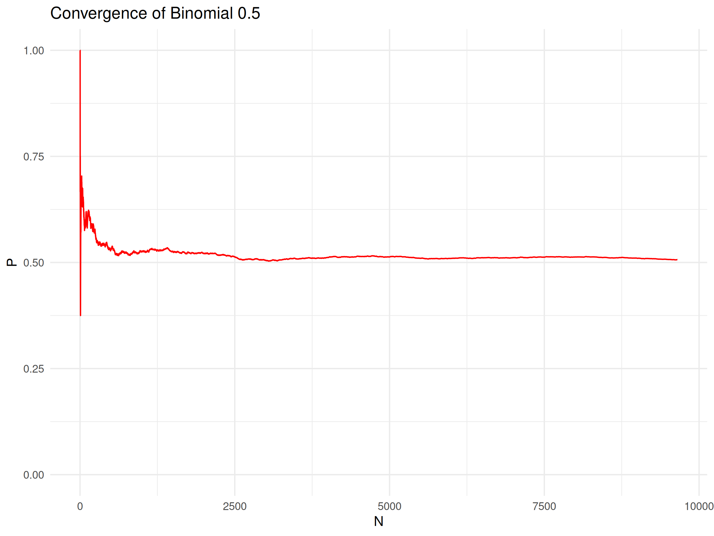
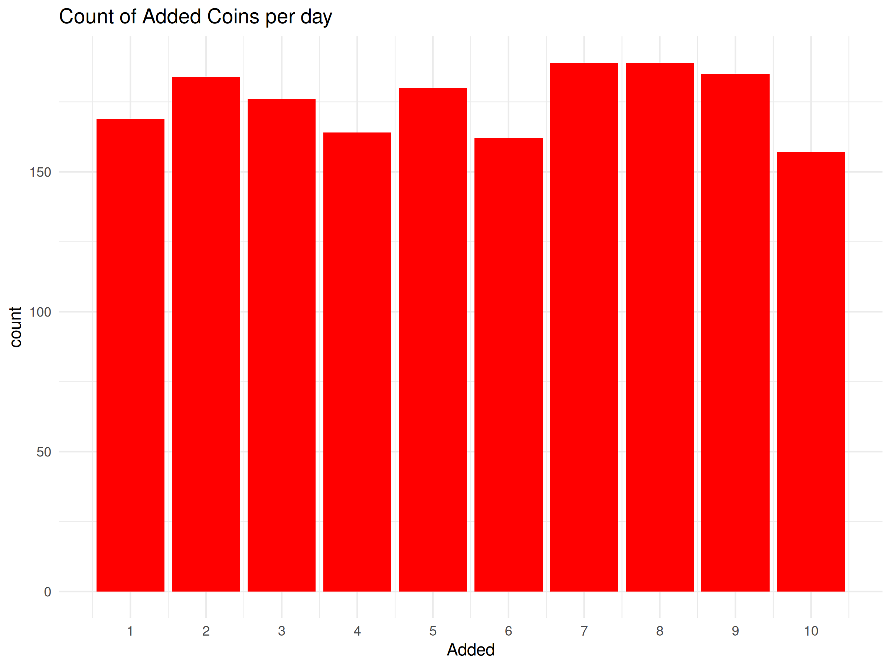

# Status of the operation
  
  This is a daily random binomial generator.
  
## Procces info

|     | Session|Date                       |       Seed| Added|
|:----|-------:|:--------------------------|----------:|-----:|
|1733 |    1733|2026-10-15 13:04:58.586055 | 1792069499|     4|
|1734 |    1734|2026-10-16 13:01:47.192309 | 1792155707|     6|
|1735 |    1735|2026-10-17 11:59:49.921997 | 1792238390|     3|
|1736 |    1736|2026-10-18 12:27:49.42373  | 1792326469|     7|
|1737 |    1737|2026-10-19 15:17:37.765858 | 1792423058|    10|
|1738 |    1738|2026-10-20 13:21:32.578321 | 1792502493|     8|
|1739 |    1739|2026-10-21 13:27:52.91113  | 1792589273|     9|
|1740 |    1740|2026-10-22 13:48:38.723457 | 1792676919|     8|
|1741 |    1741|2026-10-23 13:05:20.048697 | 1792760720|     8|
|1742 |    1742|2026-10-24 12:28:05.533132 | 1792844886|     8|
|1743 |    1743|2026-10-25 12:58:17.406573 | 1792933097|     1|
|1744 |    1744|2026-10-26 14:51:42.920723 | 1793026303|     4|
|1745 |    1745|2026-10-27 14:18:51.728668 | 1793110732|     4|
|1746 |    1746|2026-10-28 14:52:16.96941  | 1793199137|     2|
|1747 |    1747|2026-10-29 14:58:01.109326 | 1793285881|     5|
|1748 |    1748|2026-10-30 14:51:16.325937 | 1793371876|    10|
|1749 |    1749|2026-10-31 14:18:48.241326 | 1793456328|     4|
|1750 |    1750|2026-11-01 14:46:12.84493  | 1793544373|     6|
|1751 |    1751|2026-11-02 17:50:50.692966 | 1793641851|    10|
|1752 |    1752|2026-11-03 15:50:40.420468 | 1793721040|     2|

## Charts 

## End

Thats it, thanks for watching!
