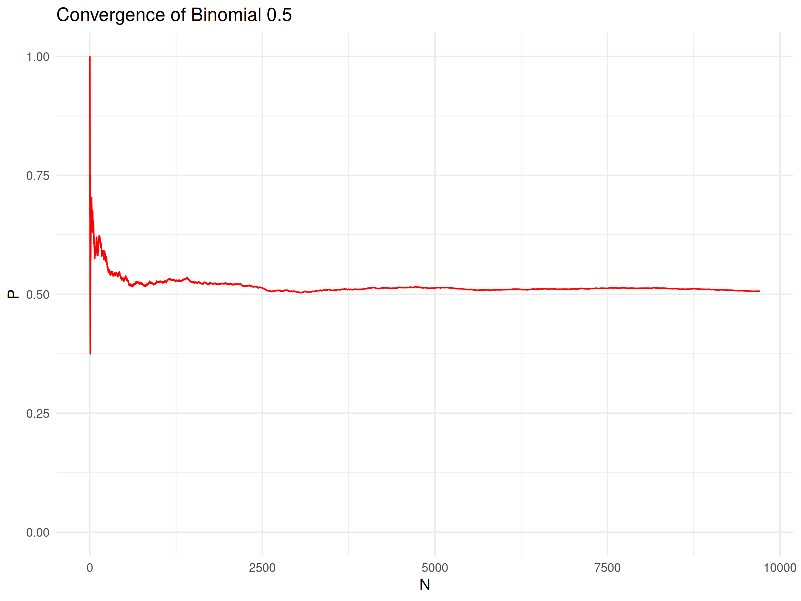
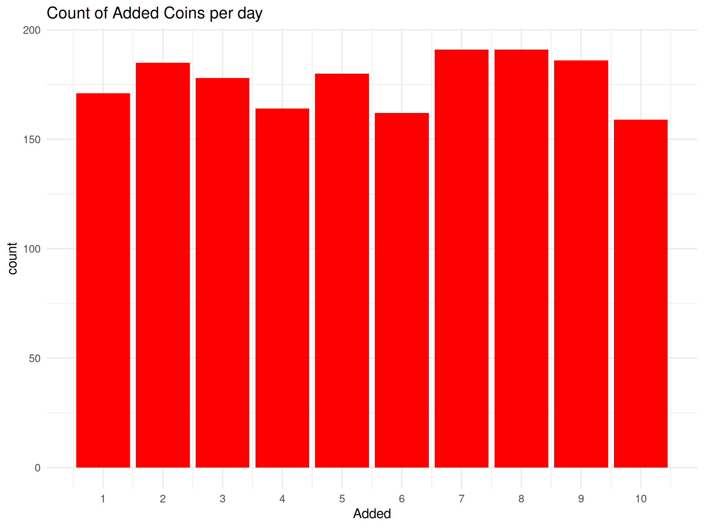

# Status of the operation
  
  This is a daily random binomial generator.
  
## Procces info

|     | Session|Date                       |       Seed| Added|
|:----|-------:|:--------------------------|----------:|-----:|
|1753 |    1753|2026-11-04 16:05:51.326675 | 1793808351|     5|
|1754 |    1754|2026-11-05 16:09:48.864192 | 1793894989|     3|
|1755 |    1755|2026-11-06 15:40:56.45803  | 1793979656|     4|
|1756 |    1756|2026-11-07 14:41:30.348682 | 1794062490|     8|
|1757 |    1757|2026-11-08 14:46:54.947005 | 1794149215|     7|
|1758 |    1758|2026-11-10 16:06:49.136749 | 1794326809|    10|
|1759 |    1759|2026-11-12 16:35:36.494159 | 1794501336|    10|
|1760 |    1760|2026-11-13 15:56:14.114345 | 1794585374|     1|
|1761 |    1761|2026-11-14 14:47:13.173957 | 1794667633|     9|
|1762 |    1762|2026-11-15 15:22:58.138387 | 1794756178|     1|
|1763 |    1763|2026-11-16 17:58:34.20707  | 1794851914|     7|
|1764 |    1764|2026-11-17 17:23:58.683634 | 1794936239|     2|
|1765 |    1765|2026-11-18 16:57:25.931949 | 1795021046|     3|
|1766 |    1766|2026-11-19 17:03:54.901258 | 1795107835|     3|
|1767 |    1767|2026-11-20 16:43:54.064662 | 1795193034|     8|
|1768 |    1768|2026-11-21 15:55:11.056067 | 1795276511|     1|
|1769 |    1769|2026-11-22 15:56:39.653193 | 1795363000|     4|
|1770 |    1770|2026-11-23 19:53:51.606282 | 1795463632|     5|
|1771 |    1771|2026-11-24 19:21:02.187142 | 1795548062|     3|
|1772 |    1772|2026-11-25 18:26:31.249637 | 1795631191|    10|

## Charts 

## End

Thats it, thanks for watching!
