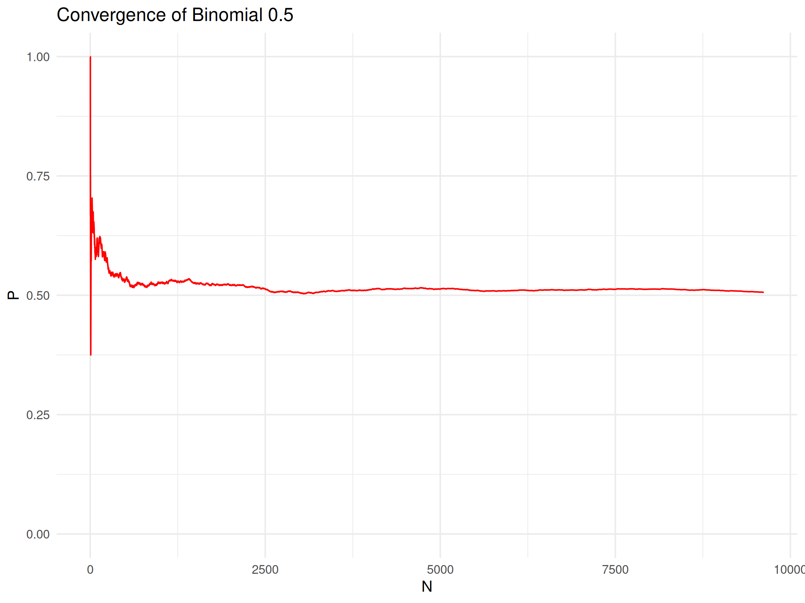
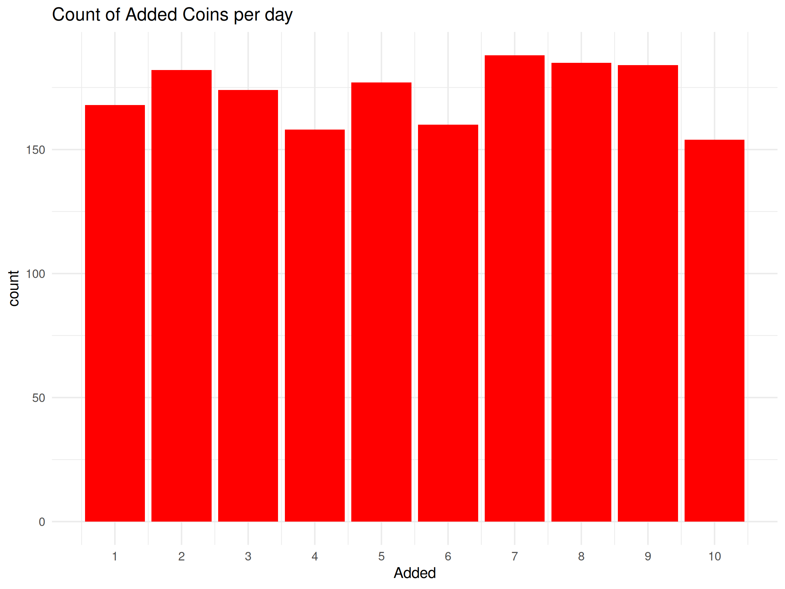

# Status of the operation
  
  This is a daily random binomial generator.
  
## Procces info

|     | Session|Date                       |       Seed| Added|
|:----|-------:|:--------------------------|----------:|-----:|
|1723 |    1723|2026-10-05 16:50:02.590561 | 1791219003|     1|
|1724 |    1724|2026-10-06 14:46:11.270042 | 1791297971|     4|
|1725 |    1725|2026-10-07 15:22:27.518646 | 1791386548|     8|
|1726 |    1726|2026-10-08 15:14:25.260704 | 1791472465|     1|
|1727 |    1727|2026-10-09 14:59:46.88151  | 1791557987|     3|
|1728 |    1728|2026-10-10 14:15:23.174449 | 1791641723|     8|
|1729 |    1729|2026-10-11 14:40:33.611104 | 1791729634|     8|
|1730 |    1730|2026-10-12 17:25:42.020144 | 1791825942|     7|
|1731 |    1731|2026-10-13 15:36:49.990398 | 1791905810|     4|
|1732 |    1732|2026-10-14 13:19:36.794644 | 1791983977|     5|
|1733 |    1733|2026-10-15 13:04:58.586055 | 1792069499|     4|
|1734 |    1734|2026-10-16 13:01:47.192309 | 1792155707|     6|
|1735 |    1735|2026-10-17 11:59:49.921997 | 1792238390|     3|
|1736 |    1736|2026-10-18 12:27:49.42373  | 1792326469|     7|
|1737 |    1737|2026-10-19 15:17:37.765858 | 1792423058|    10|
|1738 |    1738|2026-10-20 13:21:32.578321 | 1792502493|     8|
|1739 |    1739|2026-10-21 13:27:52.91113  | 1792589273|     9|
|1740 |    1740|2026-10-22 13:48:38.723457 | 1792676919|     8|
|1741 |    1741|2026-10-23 13:05:20.048697 | 1792760720|     8|
|1742 |    1742|2026-10-24 12:28:05.533132 | 1792844886|     8|

## Charts 

## End

Thats it, thanks for watching!
